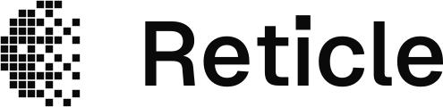

<div align="center">

<picture>
  <source media="(prefers-color-scheme: dark)" srcset="packages/tokens/brand/reticle-logo-dark.svg">
  
</picture>

### CSST106 · Perception and Computer Vision

Seven computer vision laboratory experiments and the Web UI that runs them, in one monorepo.

<p>
  
  
</p>
<p>
  
  
  
  
  
  
  
  
  
</p>

[Labs](#labs) · [Setup](#setup) · [Running](#running) · [Differences from the lab sheets](#where-the-code-differs-from-the-lab-sheets) · [Data sources](#data-sources)

</div>

## Layout

Laboratory Experiments 1-7 and their Web UI, in one app-centric monorepo. The site and its design
system are called Reticle.

```text
apps/
  web/            Astro site with React islands, organized by feature
  api/            FastAPI modular monolith: one module per lab, shared code in core/
packages/
  cv-labs/        Python code for Labs 1-7, with sample images, weights and tests
  tokens/         Reticle design tokens, fonts and brand files
  ui/             Reticle components (@reticle/ui)
  api-client/     Generated API types, typed client, shared TanStack Query client
  config/         Shared TypeScript, ESLint and Prettier settings
infra/            Deployment files (not added yet)
docs/report/      Laboratory report
scripts/          run_all.py, export_openapi.py
outputs/          Generated results for each lab
data/, models/    Downloaded datasets and weights (not in Git)
```

## Rules

- Apps depend on packages, never the reverse.
- A feature in `apps/web/src/features` is imported only through its `index.ts`, and features do not
  import each other. ESLint enforces this.
- An API module in `apps/api/src/api/modules` uses `api.core` and `cv_labs`, and does not import
  other modules.
- `cv-labs` knows nothing about HTTP.

## Labs

| Lab | Topic                                                | Code (`packages/cv-labs/src/cv_labs/`) | Results          |
| --- | ---------------------------------------------------- | -------------------------------------- | ---------------- |
| 1   | Image manipulation                                   | `lab01_images.py`                      | `outputs/lab01/` |
| 2   | Edge detection (Sobel, Canny)                        | `lab02_edges.py`                       | `outputs/lab02/` |
| 3   | Histogram equalization, CLAHE, contrast stretching   | `lab03_histogram.py`                   | `outputs/lab03/` |
| 4   | SURF, SIFT, ORB, U-SURF, feature matching            | `lab04_surf.py`, `surf.py`             | `outputs/lab04/` |
| 5   | Eigenfaces (PCA) with an SVM                         | `lab05_pca.py`                         | `outputs/lab05/` |
| 6   | YOLOv11 detection and custom training                | `lab06_yolo.py`                        | `outputs/lab06/` |
| 7   | Thresholding, region, edge and semantic segmentation | `lab07_segmentation.py`                | `outputs/lab07/` |

Lab numbers follow the file names (`CSST106_Lab_Experiment_01` to `07`).
Each results folder has the images, plus JSON files with the measured values.

## Setup

Needs [uv](https://docs.astral.sh/uv/), Node.js 20 or newer, and pnpm. uv installs Python 3.12, which
is required because PyTorch's last Intel Mac release (2.2.2) does not support newer versions.

```bash
uv sync
pnpm install
```

## Running

Start each of these in its own terminal, then open http://localhost:4321. Every lab has its own
page there, and accepts a sample or your own image. Lab 6 also accepts video and a webcam.

```bash
pnpm dev:api
```

```bash
pnpm dev:web
```

Other commands:

```bash
uv run python scripts/run_all.py                    # every lab except YOLO training
uv run python -m cv_labs.lab02_edges --image photo.jpg
pnpm test:py                                        # Python tests
pnpm typecheck
pnpm lint
pnpm build
pnpm gen:api                                        # regenerate frontend types after API changes
```

Labs 1-4 accept `--image`. Lab 4 also takes `--second` for a real image pair.

### Lab 6

```bash
uv run python -m cv_labs.lab06_yolo detect --image packages/cv-labs/samples/bus.jpg
uv run python -m cv_labs.lab06_yolo stream --source 0 --show      # webcam; press q to stop
uv run python -m cv_labs.lab06_yolo prepare
uv run python -m cv_labs.lab06_yolo train --epochs 30 --imgsz 320 --batch 8
uv run python -m cv_labs.lab06_yolo evaluate
```

## Where the code differs from the lab sheets

- **SURF (Lab 4):** `cv2.xfeatures2d.SURF_create` fails on the `opencv-contrib-python` wheels from
  PyPI, because they exclude patented algorithms. `surf.py` implements the published method in NumPy,
  and OpenCV's version is used automatically on a build that includes it. It is pure Python array
  code, so its timings cannot be compared with compiled SIFT and ORB.
- **YOLO weights (Lab 6):** the sheet writes `YOLOv11n.pt`; the published file is `yolo11n.pt`.
- **YOLO training (Lab 6):** the sheet uses 100 epochs at 640 px. The saved run uses 30 epochs at
  320 px on a 120-image subset, because this computer trains on a dual-core CPU.
- **YOLO dataset (Lab 6):** the saved run uses the public African Wildlife dataset (buffalo, elephant,
  rhino, zebra), not self-collected photos.
- **Display:** results are saved as files instead of using `cv2.imshow`, except the webcam window.
- **Images:** the sheets name files such as `input.jpg` that were not included, so
  `packages/cv-labs/samples/` holds public test images from scikit-image and Ultralytics, plus a
  synthetic image with a known mask for Lab 7's IoU.

## Data sources

- Labeled Faces in the Wild, through scikit-learn
- African Wildlife dataset and YOLO11n weights, from Ultralytics
- DeepLabV3 MobileNetV3-Large weights, from torchvision
- Home page hero footage, from NASA, "Spacewalks in HD 2020-2021"
